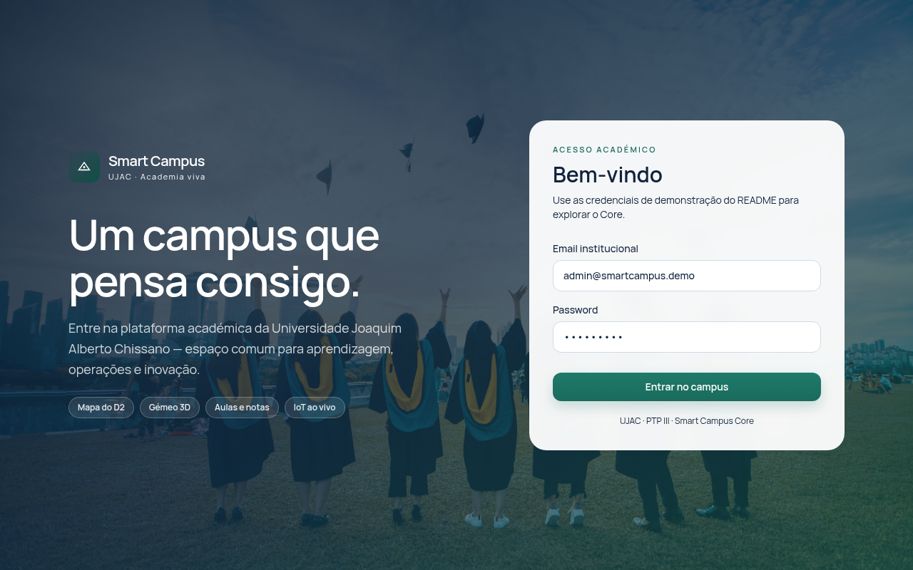
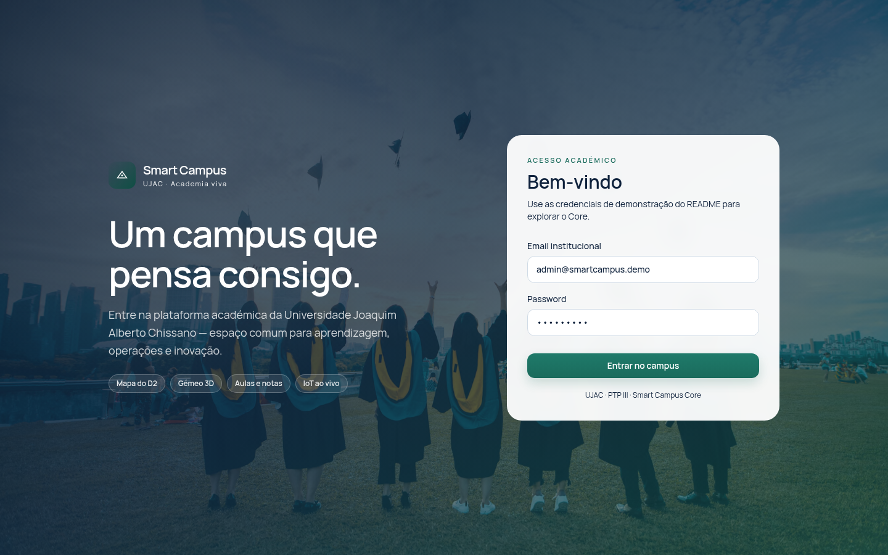

# Manual do Utilizador - Modulo de Avaliacoes e Notas

**Sistema:** Smart Campus · **Modulo:** Avaliacoes e notas (`/assessments`) · **Grupo 3** · **Versao:** 2026-11

---

## 1. Acesso

1. Abrir o browser em `http://localhost:5173` (desenvolvimento) ou o URL de producao.
2. Introduzir email e password e clicar em **Entrar**.

Perfis com acesso ao modulo: **Estudante, Docente, Coordenador, Administrador**. O menu lateral mostra "Avaliacoes e notas" apenas para estes perfis.

## 2. Visao do docente

### 2.1 Criar uma avaliacao

1. Menu **Avaliacoes e notas**.
2. Preencher o formulario (titulo, tipo TEST/EXAM/RECURRENCE, peso, modo de nota, escala).
3. Clicar em **Criar avaliacao**. Mensagem: "Avaliacao criada com sucesso."

### 2.2 Lancar notas

1. Seleccionar a avaliacao na lista.
2. Clicar em **Abrir pauta**.
3. Introduzir a nota de cada estudante (apenas estudantes **inscritos** na disciplina aparecem).
4. Clicar em **Guardar notas**. Mensagem: "Notas lancadas com sucesso."

Estudantes nao inscritos nao aparecem na pauta e nao podem receber nota (bloqueio `STUDENT_NOT_ENROLLED`).

### 2.3 Quadro da disciplina (Frequencia e Dispensa)

1. Aba **Frequencia e Dispensa**.
2. Seleccionar a disciplina.
3. Configurar regras: **Testes exigidos**, **Minimo para recorrencia**, **Nota minima de dispensa** -> **Guardar regras**.
4. Lancar notas de exame/recorrencia (estudantes dispensados nao recebem campo).
5. Dispensar estudante ao criterio do docente: introduzir a nota de dispensa e clicar em **Dispensar**. Para anular: **Anular dispensa**.

Regras:
- Dispensa automatica se admissao >= 14 (ou >= nota minima definida).
- Uma unica negativa (nota < 10) veta a dispensa de forma permanente, mesmo que a nota seja depois corrigida.
- Admissao abaixo do minimo definido pelo docente impede a dispensa.

### 2.4 Publicar resultados

1. Aba **Frequencia e Dispensa** -> **Publicar resultados** (bloqueado se os criterios de recorrencia nao estiverem configurados).
2. Enquanto publicada, as notas nao podem ser alteradas. Para corrigir: **Reabrir pauta**.

### 2.5 Eliminar avaliacao

1. Na lista, clicar no icone de lixo.
2. Confirmar no dialogo. A eliminacao e recusada (409) se a avaliacao tiver notas ou a pauta estiver publicada.

## 3. Visao do estudante

1. Menu **Avaliacoes e notas**.
2. Ver as suas notas por disciplina (bloqueado se houver divida financeira: "Deve regularizar a sua situacao financeira para consultar as notas").
3. Ver a pauta final (admissao, exame, recorrencia, final, estado).

## 4. Notificacoes em tempo real

O sino (🔔) no topo mostra o numero de notificacoes por ler e um ponto colorido com o estado da ligacao (verde = ligado, amarelo pulsante = a ligar, vermelho = erro, cinzento = desligado). As notificacoes de novos horarios e notas chegam automaticamente sem recarregar a pagina.

## 5. Resolucao de problemas

| Situacao | Causa / solucao |
|---|---|
| Modulo nao aparece no menu | Perfil sem permissao (FINANCE/TECHNICIAN). Usar STUDENT/TEACHER/COORDINATOR/ADMIN. |
| "Deve regularizar a sua situacao financeira" | Divida em atraso. Pagar via Tesouraria. |
| "Estudante nao inscrito nesta disciplina" | Inscrever o estudante via modulo de Matriculas. |
| "Dispensa recusada: negativa" | Uma nota < 10 foi registada; a dispensa fica vetada permanentemente. |
| Pauta nao publica | Configurar o minimo de admissao para recorrencia. |

---

